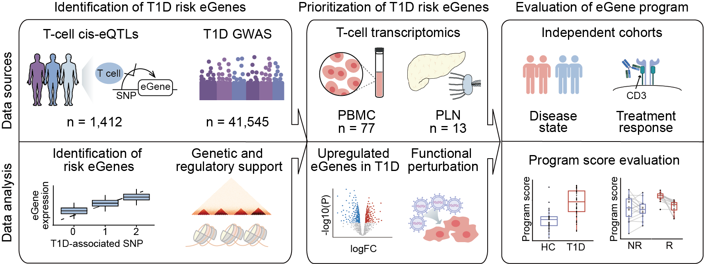

# Multi-omic variant-to-gene mapping prioritizes candidate effector genes for type 1 diabetes in T cells

This repository contains the analysis code accompanying our study integrating genetic, epigenomic, transcriptomic, and functional evidence to identify and characterize type 1 diabetes (T1D)-associated genes in T cells.

## Repository Structure

- **01_GWAS_eQTL_integration/**  
  T-cell eQTL meta-analysis, GWAS integration, and identification of T1D risk eGenes (Figure 1).

- **02_Genetic_and_chromatin_analysis/**  
  Genetic colocalization, ATAC-seq, Hi-C, and chromatin-based variant-to-gene mapping (Figure 2).

- **03_Disease_scRNAseq/**  
  PBMC and pancreatic lymph node single-cell transcriptomic analyses, and differential expression (Figure 3).

- **04_CRISPR_perturbation/**  
  CRISPR-based functional screening and validation in murine CD4⁺ and CD8⁺ T cells (Figure 4).

- **05_Gene_prioritization_and_program/**  
  Evidence-based gene prioritization, construction of a weighted T-cell transcriptional program, and evaluation across independent T1D and teplizumab-treated cohorts (Figure 5).

## Data Availability

Public datasets were obtained from the original repositories, including GEO, HPAP PANC-DB, Synapse, and Zenodo. Detailed accession numbers and data sources are provided in the manuscript.
